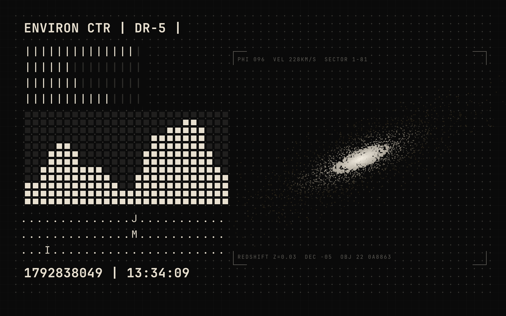
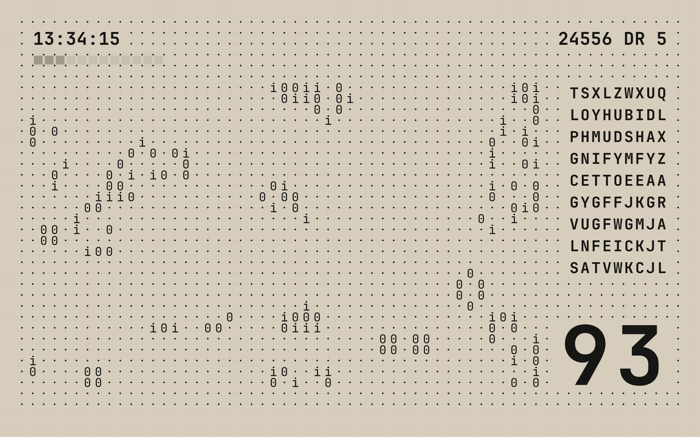
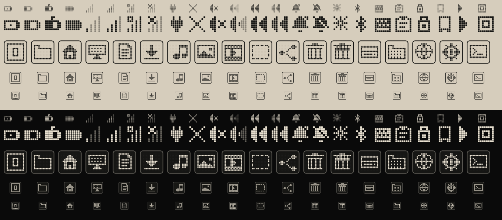
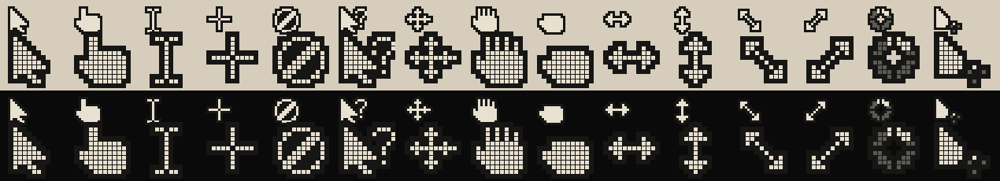
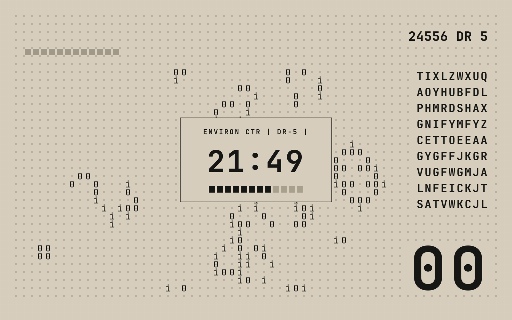
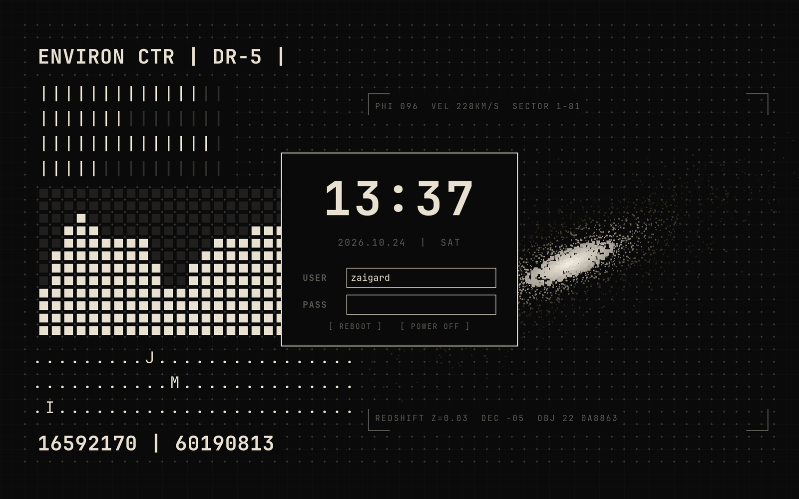
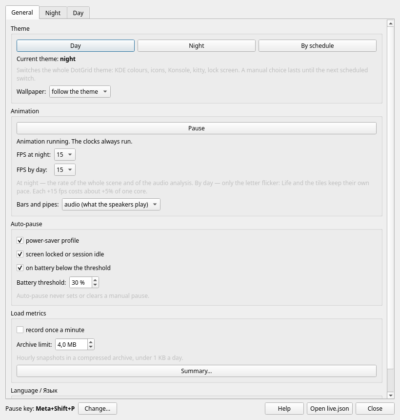
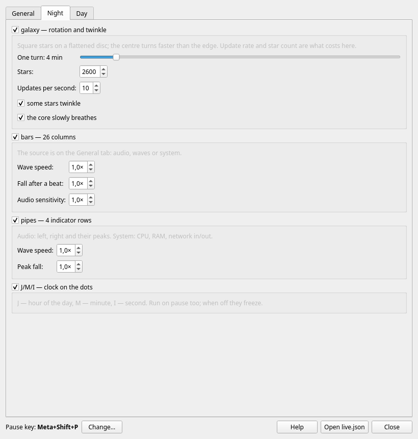

# DotGrid for KDE Plasma 6

[Русская версия](README.ru.md)

A day/night theme for KDE Plasma 6 built around a 40 px dot grid, with a living wallpaper.





## Theme

- KDE colour schemes **DotGridDay** and **DotGridNight**
- matching Konsole and kitty colours, JetBrains Mono, fastfetch logo
- dot-matrix icon themes **DotGrid** / **DotGrid-Dark**: panel and tray icons (battery, network, volume, notifications, brightness, Bluetooth, keyboard, clipboard, devices, media, night light), the launcher logo, folders, trash, drives and the pinned apps. Everything else — all ~7000 Breeze icons and the icons of installed applications (hicolor) — is converted to a dot matrix automatically (**DotGrid-Auto**, `tools/dotify_icons.py`). All icons follow the colour scheme. A Plasma style **DotGrid** (Breeze with these tray icons) comes with them.
- dot-matrix **cursor** theme: SVG for Wayland (sharp at any scale) and Xcursor 24–96 px for XWayland programs; animated wait; rare shapes from Breeze
- **System Monitor** widgets as a dot matrix in the theme text colour (a column per CPU core, scrolling history for network and memory)
- **Zen Browser / Firefox**: theme colours, a dot grid behind the tabs, JetBrains Mono (`./install-browser.sh`, then restart the browser)
- **window decorations** (Aurorae): a flat title bar in the theme colours, thin frame, dot-matrix buttons; day and night versions switch with the theme
- splash screen that follows the theme, lock-screen picture, an optional SDDM login theme (day or night by the sun, since the login screen runs before the user's session) and an optional Plymouth boot splash (dot grid, 12 tiles for the boot progress)
- `dotgrid-theme day|night` switches all of it at once; a systemd user timer switches at sunrise and sunset, computed locally (no internet) for the main city of the system time zone; `LAT=`/`LON=` in `~/.config/dotgrid/schedule` (or `--lat`/`--lon`) set the place, `--day-at`/`--night-at` switch by the clock instead; `dotgrid-auto --show` prints the times. A manual switch lasts until the next sunrise or sunset









## Live wallpaper (DotGrid Live)

A Plasma wallpaper plugin, `org.dotgrid.live`, that draws the composition live:

- **Day:** clock `HH:mm:ss`, Conway's Game of Life on the grid dots, a 9×9 letter matrix, 12 progress tiles and the battery charge in big digits.
- **Night:** `unix | HH:mm:ss` clock, a rotating galaxy of square stars and 26×12 bars with VU pipes. The bars and pipes follow the audio spectrum, the system load (CPU, RAM, network) or generative waves. J/M/I markers show the hour, minute and second on dot rows.
- **Pause** from the tray, a global shortcut (Meta+Shift+P) or the `dotgrid-live` command. Auto-pause covers power-saver, low battery and a locked screen. The clocks keep running on pause; nothing else moves or uses the CPU.
- **Settings window** with every element on its own panel: speeds, star count, Life rules, letter flicker, tile source. FPS is set separately for day and night. English and Russian.
- **Optional load log:** CPU, memory and battery draw once a minute, folded into compressed hourly snapshots.

No custom shaders: static layers are drawn once, and the galaxy is a single geometry node in a small C++ module.





## Requirements

- KDE Plasma 6 (Wayland or X11), Qt 6.5 or newer
- Arch Linux or a derivative for the automatic package installation; elsewhere install the equivalents by hand

| Purpose | Arch packages |
|---|---|
| theme | `plasma-workspace`, `kconfig` (`kwriteconfig6`), `curl`, `ttf-jetbrains-mono`, `librsvg`, `python-pillow` |
| wallpaper build | `cmake`, `ninja`, `gcc`, `qt6-base`, `qt6-declarative`, `kpackage` |
| tray, service, CLI | `pyside6`, `python-dbus` |
| audio bars (optional) | `python-numpy`, `pipewire`, `libpulse` |

The Doto font is downloaded from Google Fonts during installation.

## Installation

Everything is installed per user into `~/.local` and `~/.config`. `sudo` is only used to install missing packages, after asking.

```sh
./install.sh                 # theme only
./install.sh --live          # theme + live wallpaper
./install.sh --live-only     # live wallpaper for an existing DotGrid theme
./install-system.sh          # login screen + boot splash (needs sudo; or ./install-sddm.sh, ./install-plymouth.sh)
```

Useful `install.sh` options: `--day` / `--night`, `--lat LAT --lon LON`, `--day-at HOUR --night-at HOUR`, `--no-auto`, `--no-apply`, `--icons-day THEME --icons-night THEME`, `--no-icons`, `--no-cursor`, `--no-decoration`, `--no-monitors`, `--no-splash`, `--yes`.

Icons, cursor, window decorations and splash alone (for an existing install): `./install-look.sh`; the previous ones are remembered and `./uninstall-look.sh` restores them.

Arch package for the live wallpaper (system-wide):

```sh
cd packaging && makepkg -si
systemctl --user enable --now dotgrid-livectl.service
```

Then select **DotGrid Live** in *Configure Desktop and Wallpaper*.

### Removal

```sh
./uninstall-live.sh          # back to the static wallpaper; --purge also removes settings
./install-system.sh --uninstall   # login screen and boot splash; the previous Plymouth theme comes back
```

## Usage

| | |
|---|---|
| tray icon | left click: pause/resume; middle click: settings; menu: theme, bars source, FPS, elements, auto-pause, language, help |
| `dotgrid-live` | `status`, `toggle`, `theme day\|night\|schedule`, `fps day\|night N`, `element NAME on\|off`, `opt ELEMENT KEY VALUE`, `metrics` and more; run without arguments for the list |
| `dotgrid-theme day\|night` | switch the whole theme |
| `~/.config/dotgrid/live.json` | all live wallpaper settings |

